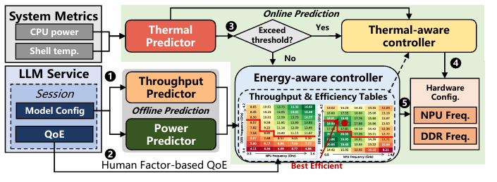
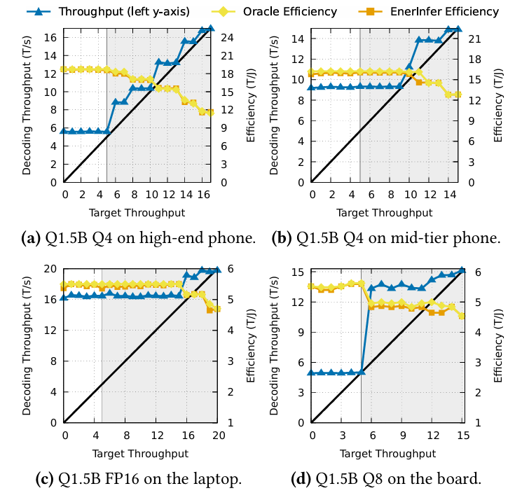
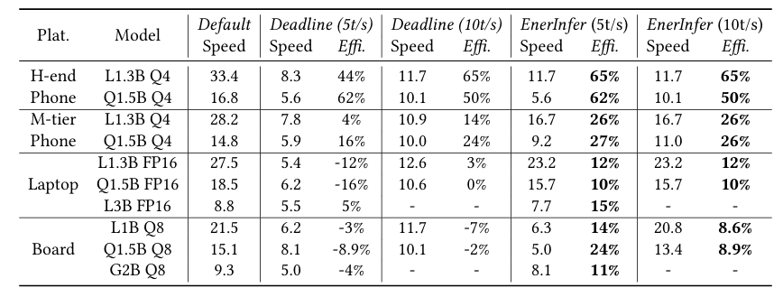

# 7.30

## 1. 论文

### 1.1 出处

- 《EnerInfer: Energy-Aware On-Device LLM Inference》（arxiv202606）

### 1.2 问题

- 无上限的NPU频率对实际体验改善有限
- 略微降低频率可以提高`tokens/J`

### 1.3 设计

#### 1.3.1 吞吐预测

- **解耦预测**：分开预测模型的因素和硬件（NPU、内存）的因素

- 使用模型结构参数如Transformer 层数、hidden size、attention head 数等预测峰值吞吐

$$
R_{max}=f_{peak}(模型结构)
$$

- 然后预测硬件频率组合对峰值吞吐的缩放比例

$$
α_{i,j}=f_{scale}(模型结构,f_{NPU,i},f_{DDR,j})
$$

- 得到最终预测值

$$
R_{i,j}=R_{max}⋅α_{i,j}
$$

#### 1.3.2 功耗和能效预测

- **功耗预测**：模型结构参数、NPU和内存频率 $\rightarrow$功率
- 能效定义为：

$$
E(u)=\frac{P(u)}{R(u)}
$$

- 单位为tokens/J

#### 1.3.3 Energy-aware控制器

- Prefill时NPU 和内存均设置为最大频率，以降低 TTFT。
- decode时：
  - 先使用满足目标 TPS 且预测能效最高的配置
  - 如果实际生成速度低于目标，控制器沿候选列表切换到更高性能的配置。

#### 1.3.4 温度控制器

- 温度控制器根据最近20s的温度预测未来1-21s的温度
- 热控制器预测在达到温度阈值前能够生成多少 token
- 最大化达到温度阈值前生成的token数

### 1.4 实验

- 使用模型：
  - LLaMA2/Chinese-LLaMA2 1.3B；
  - LLaMA 3/3.2 3B；
  - Qwen2 1.5B；
  - Gemma2 2B；
  - 实际应用中的 Pangu-π。
- 手机上使用4bit量化

- 结果

### 1.5 Thinking

- 本文的方法不会引起生成质量的变化
- 实际任务中考虑质量-耗能-时间的平衡
