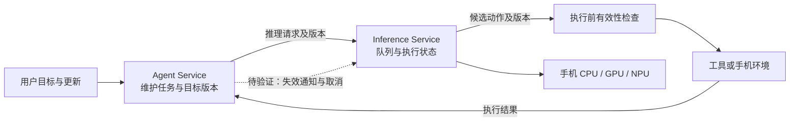

# 手机端 Agent 的动态意图与推理服务协同

> **旧版已被替代，请阅读[2026-10-29新版汇报稿](08_mobile_agent_inference_research_briefing_20261029.md)。** 下文保留历史内容，研究建议不再有效：补查发现[Retire](https://arxiv.org/abs/2610.01160)已覆盖原稿主线中的版本化撤销、过期计算停止与有效状态继承，故撤回原主线推荐。新版从现有工作与近期演进重新推导候选问题。

## 现有工作、近期趋势与可开展的研究

**汇报日期：2026年10月28日**  
**研究范围：手机端侧LLM推理，重点关注用户中断、目标更新与过期计算。**

> 核心判断：用户在任务执行中改变意图，已经有明确的研究与公开基准。值得进一步验证的是：当目标更新发生在手机模型排队或推理期间，上层语义变化能否及时传播到推理执行层，以及取消、继续当前执行段、合并后续更新之间是否存在需要协同决策的成本。
>
> 当前建议以问题测量为起点，先证明损失和简单方案的边界，再决定是否设计新机制。本文提出的方向尚未经过新增真机实验验证。

## 1. 研究背景：从“生成一个回答”到“持续完成一个任务”

手机Agent的执行通常包含多次观察、推理和工具调用。模型请求只是任务执行过程中的一个阶段，用户目标和外部状态可能在请求完成前发生变化。

以闹钟任务为例，以下是一个**用于说明问题的假设场景**：

```text
t0：用户要求“设置明天上午9点的闹钟”
t1：Agent提交推理请求，模型开始生成工具调用
t2：用户补充“改成上午10点”
t3：旧请求仍在生成，或已经返回“设置9点”的调用
t4：Agent需要阻止旧动作，并根据新目标继续执行
```

这个过程包含三个不同问题：

| 层次 | 要回答的问题 | 典型研究对象 |
|---|---|---|
| 任务理解与规划 | Agent能否理解更新，并修改后续计划？ | 用户中断、意图修订、轨迹修复 |
| 动作有效性 | 基于旧目标或旧观察生成的动作，还能否执行？ | 版本检查、提交时校验、观察—动作一致性 |
| 推理执行与资源 | 已失效的请求是否还占用队列和加速器？取消是否值得？ | 取消传播、执行边界、恢复成本、有效响应时延 |

前两层已有直接研究。第三层与手机推理后端、状态管理和交互时序密切相关，是本次重点考察的切入点。**这并不意味着第三层完全无人研究，而是需要将已有机制放到具体手机闭环中逐项验证。**

同时，**收到新消息不等于旧计算全部失效**。追加一个兼容要求可能允许保留已有进展；修改正在生成的工具参数可能使旧调用失效；明确取消才表示不再继续原任务。实验应区分这些情况，不能把版本号变化自动当成所有状态均不可复用。

## 2. 现有工作已经覆盖了哪些内容

### 2.1 用户中断与任务信息变化：已经有直接基准

**InterruptBench**专门研究长任务执行中用户追加、修订和撤回要求。它基于WebArena-Lite构造场景，先执行初始目标并记录轨迹，再在指定进度注入更新，评估Agent能否完成最终目标。[论文](https://arxiv.org/abs/2604.00892)、[项目](https://github.com/HenryPengZou/InterruptBench)。

**HammerBench**包含手机场景的多轮函数调用，专门设置意图变化和参数修改类型，适合分析用户更新后是否选择正确工具和参数。它主要提供对话及调用标签，不能直接给出手机执行中的资源成本。[论文](https://aclanthology.org/2025.findings-acl.175/)、[数据](https://huggingface.co/datasets/MadeAgents/HammerBench)。

近期工作还将更新来源扩展到异步执行：**Async-RBench**研究子Agent结果抵达后，主Agent应修改哪些工作、保留哪些内容、避免哪些操作，以及重新验证哪些结论；**AmbiBench**则强调手机GUI任务中的模糊指令、用户澄清与意图对齐。[Async-RBench](https://arxiv.org/abs/2610.32429)、[AmbiBench](https://arxiv.org/abs/2602.11750)。

由此可见，“用户会改口”“Agent需要根据新信息重规划”本身不能作为新问题。需要进一步明确研究的是**任务适应能力，还是适应过程中的系统执行成本**。

### 2.2 动态观察与动作有效性：旧输入可能产生不再适用的动作

Android上的**Action Rebinding**研究说明，观察与动作之间的时间间隙可能被前台状态变化利用；**Commit-Time Authorization**进一步研究在持久动作提交时重新验证版本、绑定与授权证据。这些工作限制了“给动作增加epoch检查”的新颖性。[Action Rebinding](https://arxiv.org/abs/2601.12349)、[Commit-Time Authorization](https://arxiv.org/abs/2607.10487)。

另一方面，**AOI**通过连续观察与离散动作解耦，使Agent能够接收动态界面和音频信息；**PastForward**利用历史输出和下一屏预测重叠计算，验证预测后保留可复用结果。[AOI](https://arxiv.org/abs/2606.29472)、[PastForward](https://arxiv.org/abs/2609.32166)。

这些先例说明：连续感知、版本检查、预测后验证都有已有方法。候选方向必须回答更具体的问题，例如：**上层已经确定旧目标失效后，推理服务仍继续运行多久，以及怎样停止才具有实际收益。**

### 2.3 Agent与推理服务协同：也已经形成系统研究路线

| 工作 | 核心贡献 | 对本研究的启示或约束 |
|---|---|---|
| [Parrot，2024](https://arxiv.org/abs/2405.19888) | 将应用语义依赖暴露给LLM服务，支持跨请求优化 | “向下传递Agent语义”本身已有先例 |
| [InferCept，2024](https://arxiv.org/abs/2402.01869) | 处理工具等外部交互造成的推理中断与状态保存／换出／重算 | 工具等待与KV管理不能作为全新问题 |
| [Continuum，2025—2026](https://arxiv.org/abs/2511.02230) | 联合工具返回时间、KV保留TTL和程序级调度 | 需要比较任务完成时间，不能只看缓存命中 |
| [Agent.xpu，2025—2026](https://arxiv.org/abs/2506.24045) | 根据前后台Agent流协调异构执行、优先级与抢占 | 普通优先级和抢占必须作为已有基线；实测平台为Intel迷你PC |
| [ElastiLM，MobiCom 2025](https://xumengwei.github.io/files/MobiCom25-ElastiLM.pdf) | 在真实手机上调整模型与提示规模以满足请求SLO | 按任务需求调整推理能力也已有手机先例 |
| [Sereno，OSDI 2026](https://www.usenix.org/conference/osdi26/presentation/xin) | 缓解手机NPU推理与前台应用的带宽争用 | 必须计入前台影响；共享资源干扰并非空白 |
| [Tandem，2026-10](https://arxiv.org/abs/2610.26660) | 联合GUI混合模型检查点、短输出推测与NPU空闲功耗管理 | 手机Agent特有的状态与执行周期已经被利用 |

需要区分两种“中断”：**工具调用引起的暂停通常仍会继续原任务；目标被更新则可能使原请求的输出失去执行价值。** 二者都可能涉及状态管理，但不能直接视为同一个优化目标。

同样，框架支持取消API，也不等于已解决跨层问题。取消请求是否抵达后端、何时释放执行资源、是否破坏可复用状态，都需要实测。工程社区已有“界面显示取消但底层请求仍运行”的报告；例如Hermes Console的相关issue可作为排查线索，但它不是手机场景发生率的证据。[工程案例](https://github.com/NousResearch/hermes-agent/issues/106179)。

## 3. 近期研究趋势与仍需补充的证据

综合上述工作，可以看到三个趋势：

1. **评测从一次性指令转向持续交互。** 用户更新、澄清和异步结果逐渐进入任务评估，最终成功率之外，还需要分析更新后的适应过程。
2. **优化单位从单次请求转向任务。** 排队、工具执行、状态恢复和观察都可能进入关键路径，单独提高tok/s未必改善有效动作或任务完成时间。
3. **手机执行开始显式考虑Agent特征。** 短工具输出、改写历史、屏幕变化和请求间空闲，已经影响检查点、推测执行和功耗设计。

目前最需要补充的是一条完整的证据链：

**有应用依据的目标更新 → 旧请求确定失效 → 手机执行资源继续被占用 → 简单取消或覆盖仍存在不足 → 跨层决策带来额外价值。**

其中任何一环不成立，都应缩小或放弃相应选题。特别是，不能从“公开基准包含用户中断”直接推出“真实手机用户频繁在模型推理中改口”，也不能从“手机推理较慢”直接推出“需要复杂取消调度”。

## 4. 建议聚焦的问题与可做的工作

### 4.1 主问题：目标更新后，手机推理应如何停止或切换

建议暂定研究问题为：

> 在用户目标持续更新的手机Agent中，如何将目标有效性与推理执行状态联合考虑，减少旧请求对新目标的阻塞，同时保持工具动作正确并控制取消与恢复开销？

第一阶段仅处理**显式用户更新**，不同时解决任意GUI变化、任意工具数据变化和复杂语义依赖。任务版本可以由Agent Service可靠维护，便于排除失效检测误差。

起步时选择具有明确冲突判据的参数覆盖与显式取消，再加入兼容追加作为对照。版本号负责标识更新，失效判定则依据任务约束；不假设一个通用语义分类器已经能准确处理任意用户更新。



图中虚线是拟研究的传播路径，**不表示现有runner已经支持运行中取消**。版本字段是机制接口，不单独作为科研贡献。

### 4.2 工作一：测量失效通知与资源释放之间的差距

先不开发新算法，只在目标更新时记录旧请求状态，回答以下问题：

| 失效时机 | 首先测什么 | 可能出现的结论 |
|---|---|---|
| 请求仍在队列 | 是否仍被派发，是否阻塞新版本 | 最新版本覆盖队列可能已经足够 |
| 已进入prefill | 何时能停止，停止后需重建什么 | 执行段粒度可能限制取消收益 |
| 已进入decode | 还生成多久、占用多久、有效前缀能否保留 | 需要比较停止与完成当前段的成本 |
| 输出已返回、动作未执行 | 是否能阻止旧动作 | 主要是提交检查，不应把它算成推理加速 |
| 工具已执行 | 原操作能否查询、撤销或补偿 | 超出单纯推理取消范围，应另行处理 |

“失效后执行时间”只表示潜在资源机会，**不等于全部计算都不可复用**。应分别报告仍有效的公共前缀、无法再利用的生成，以及取消操作新增的开销。

### 4.3 工作二：验证成本感知的取消是否比简单规则更好

只有工作一发现明显损失后，才考虑方法设计。先比较两条路径对新目标完成时间的影响：

- **路径A**：允许当前不可中断执行段结束，丢弃旧输出，再处理最新目标。
- **路径B**：请求后端取消，完成必要状态整理，再处理最新目标。

可用信息包括当前执行阶段、可取消边界、近期阶段耗时、已完成工作量，以及新旧prompt的合法共享前缀。未来生成长度和下一次用户更新时间只能估计，不能从完整轨迹中提前读取。

若不同阶段确实存在取消开销与剩余执行时间的交叉点，可研究轻量的决策规则。若后端取消廉价且总是有利，则“及时取消”可能只是必要工程实现，不需要再设计复杂策略。

### 4.4 工作三：连续更新时合并请求，避免反复重启

用户可能连续补充参数。每次更新都立即重启，可能浪费重复prefill；等待过久又会推迟响应。可以研究有限等待窗口、最新版本合并与优先级安排。

这一部分必须比较“最新请求覆盖＋简单短暂合并”等基线。没有稳定目标区间时，不能无条件保证既不执行过期动作、又始终完成最新任务。重复更新是否常见，也需要应用依据，不能仅通过高频人工注入制造收益。

**以上三项属于同一条研究主线：测量 → 找到简单方案失效的条件 → 设计必要的控制机制。** 不建议一开始把它扩展成覆盖所有Agent资源的通用操作系统。

## 5. 可直接复用的数据与需要补充的实验层

| 资源 | 可复用内容 | 原协议缺少的系统信息 | 建议角色 |
|---|---|---|---|
| [HammerBench](https://huggingface.co/datasets/MadeAgents/HammerBench) | 对话、工具schema、意图／参数更新及调用标签 | 实际更新时间、手机执行阶段、取消和功耗记录 | 现有文本工具runner的起步小试 |
| [InterruptBench](https://github.com/HenryPengZou/InterruptBench) | 初始目标、更新消息、Web环境与最终任务评估 | 手机后端运行中取消、同步资源测量 | 长任务闭环与轨迹修复验证 |
| [Async-RBench](https://github.com/pope8zdt/Async-RBench) | 异步结果改变已有工作的任务与评测要求 | 手机推理资源和用户自然到达分布 | 后续扩展到工具／子Agent结果失效 |
| [AmbiBench](https://arxiv.org/abs/2602.11750) | 手机交互任务与用户澄清 | 模型运行期间的显式目标修订协议 | 移动交互的补充域 |
| [AndroidWorld](https://github.com/google-research/android_world) | Android任务环境和终态检查 | 原始任务不自带完整目标更新与运行中取消协议 | 后续Android GUI验证 |

**InterruptBench最接近问题语义，HammerBench最容易与当前文本工具接口衔接。** 前者公开配置按动作序号或轨迹进度注入更新；这与固定墙钟时刻、特别是prefill/decode内部抵达的更新不同。[InterruptBench运行指南](https://github.com/HenryPengZou/InterruptBench/blob/main/Eval/RUN_PARALLEL_EVAL_ZH.md)。

因此不需要从零编造任务，但需要补充一个时间与执行事件层：保持目标更新内容和正确性判据，增加更新抵达时间、请求版本、执行阶段和取消生效记录。修改后的协议应明确标为派生实验，不冒充原benchmark成绩。

本轮尚未核实到一个现成数据集同时提供**自然手机用户更新、墙钟时间、prefill/decode状态和资源测量**。受控注入可以验证机制，真实发生率和实际使用收益仍需后续交互数据。

## 6. 结合现有平台的实验计划

### 6.1 当前可复用的基础

现有平台已包括Redmi上的QNN常驻模型runner、多Session、任务就绪／排队／推理／工具事件，以及部分AppWorld闭环。它适合增加任务版本与失效事件，开展手机推理层测量。[现有闭环说明](../../code/multisession_kv/AGENT_CLOSED_LOOP.md)、[多任务说明](../../code/multisession_kv/APPWORLD_MULTISESSION_SMOKE.md)。

目前宿主脚本通过阻塞式请求调用runner；不能假定在请求执行期间，同一个控制循环已经能够及时接收和发送取消。需要先验证独立事件入口、后端取消路径与状态整理能力。关闭客户端、清除Session与停止正在执行的图也应分别测量，不能混作一种取消操作。

现有AppWorld小试中还存在模型工具格式和实体绑定错误。后续必须固定模型、提示、服务侧辅助和未参与调试的验证实例，避免把模型错误或反复调参后的通过率误当系统收益。

### 6.2 分阶段推进

| 阶段 | 具体工作 | 交付结果 | 继续条件 |
|---|---|---|---|
| A：接口与能力检查 | 确认运行中事件可被记录，探测取消粒度、Session行为与模型恢复成本 | 后端能力表、可审计时间线 | 能观察更新与执行的真实重叠；测量不被宿主阻塞隐藏 |
| B：问题量级测量 | 用HammerBench代表性任务更新，分别覆盖排队、prefill、decode阶段 | 潜在无效计算分布、正确性与响应时延 | 存在值得优化的阻塞或成本 |
| C：强简单基线 | 实现队列覆盖、取消即停、完成当前段、短暂合并与动作前检查 | 同等信息和资源下的成对对照 | 简单规则仍有稳定不足 |
| D：最小方法 | 根据实际阶段成本选择取消／等待边界／合并策略 | 一个可解释机制及必要消融 | 额外监测与恢复成本计入后仍有效 |
| E：闭环扩展 | 接InterruptBench；有条件再补Android环境与自然交互测量 | 任务终态、边界与失败案例 | 收益不依赖特殊人工更新频率或单一任务模板 |

若QNN不具备低成本运行中取消能力，先将其作为测量结果。强制杀进程重载可作昂贵基线，不宜直接作为主方法；也不应在没有收益空间证据时就开始修改NPU内核。

### 6.3 必须比较的基线

1. 旧请求正常完成，随后处理新目标；所有方案均进行动作前版本检查。
2. 仅在队列中保留最新版本。
3. 一收到更新就尝试取消，使用后端实际支持的机制。
4. 允许当前不可中断段结束，随后切换。
5. 最新版本覆盖，加固定短窗口合并。
6. 对更新后的请求提高优先级，但不使用额外有效性信息。

第一条可展示缺少及时处理的代价；论文主方法必须超过后续更强基线。不能仅打败一个完全不传播取消的实现。

### 6.4 主要指标与公平性

| 指标 | 含义 |
|---|---|
| 更新后有效响应时延 | 从更新抵达到产生仍有效、可执行的新动作的时间；纯取消任务则测取消生效时间 |
| 最终任务成功率 | 按最新目标检查终态，避免“更快但做错” |
| 过期动作提交数 | 更新后仍执行旧版本动作的次数 |
| 取消响应时延 | 从取消请求发出到后端实际停止相关执行的时间 |
| 失效后资源占用 | 旧请求在失效后继续占用执行资源的时间，并区分可复用与不可复用工作 |
| 重启与恢复成本 | 重算、重新prefill、状态整理、模型重载和额外内存 |
| 完整窗口能量 | 将失败、重试、监测与空闲保持都计入；暂不可可靠测量时先不作节能结论 |

比较策略时，保持相同目标更新内容、环境初态和外部更新时间协议。按阶段触发更新适合探测机制，但策略改变后阶段时刻也会变化；应与固定墙钟更新实验分开报告。参考轨迹只能用于控制条件或诊断，不能代替策略改变后的闭环执行。

不同策略对被取代请求的处理方式不同，需同时报告提交、被更新、被取消、超时和完成任务数量，不能将取消旧版本简单记为任务失败，也不能从统计中删掉所有困难任务。

## 7. 选题边界与预期贡献

以下内容已有明确先例，**不单独作为本方向贡献**：用户会中断任务、Agent需要重规划、请求带版本号、动作前进行检查、普通优先级抢占、KV前缀复用，以及为框架补一个取消接口。

如果实验支持，可以考虑形成以下贡献：

- **测量贡献**：说明目标更新、取消传播和手机实际资源释放之间的差距，给出发生条件与成本分布。
- **机制贡献**：针对已测出的执行边界和恢复成本，提出超过强简单基线的控制方法。
- **评测贡献**：复用现有任务语义与终态检查，补充可重放的系统时间协议、运行日志和明确的适用范围。

以下结果应触发停止或转向：

| 实验结果 | 研究决策 |
|---|---|
| 合理交互中更新极少，或几乎不与推理重叠 | 不把过期计算作为主要性能问题 |
| 最新队列覆盖与动作前检查已接近上界 | 保留工程实现，不继续复杂调度 |
| 取消廉价且始终优于等待 | 优先完善取消传播，不人为增加决策算法 |
| 后端不可中断，且重载成本超过潜在收益 | 缩小到边界测量，或调整后端／问题范围 |
| 收益仅在极端人工更新频率下出现 | 限定结论，不能推广为普通手机使用收益 |

**建议当前先做“取消传播与执行边界的测量”，再决定是否研究成本感知决策。** 不以新增模块数量或使用复杂算法作为科研价值的判断标准。

## 8. 汇报参考文献与项目

| 编号 | 论文或项目 | 一句话介绍 |
|---|---|---|
| 1 | [HammerBench，ACL Findings 2025](https://aclanthology.org/2025.findings-acl.175/) | 评估手机场景中多轮函数调用、意图变化与参数修改；[数据](https://huggingface.co/datasets/MadeAgents/HammerBench)。 |
| 2 | [When Users Change Their Mind / InterruptBench，2026](https://arxiv.org/abs/2604.00892) | 在Web长任务执行中注入追加、修订与撤回要求，评估中断后的适应；[项目](https://github.com/HenryPengZou/InterruptBench)。 |
| 3 | [Async-RBench，2026](https://arxiv.org/abs/2610.32429) | 评估异步子Agent结果返回后对已有工作的更新、保留与重新验证；[项目](https://github.com/pope8zdt/Async-RBench)。 |
| 4 | [AmbiBench，2026](https://arxiv.org/abs/2602.11750) | 通过手机GUI任务中的模糊指令与用户交互评估意图对齐能力。 |
| 5 | [Mind the Gap: Action Rebinding Attacks against Android GUI Agents，2026](https://arxiv.org/abs/2601.12349) | 研究Android观察—动作间隙中的状态变化与动作重绑定风险。 |
| 6 | [Temporary Authority, Permanent Effects，2026](https://arxiv.org/abs/2607.10487) | 在动作提交边界重新验证早期授权、绑定和执行路径的有效性。 |
| 7 | [Agent-Computer Observation Interfaces，2026](https://arxiv.org/abs/2606.29472) | 将动态连续观察与离散动作解耦，增强动态环境中的感知；[项目](https://github.com/19PINE-AI/aoi)。 |
| 8 | [PastForward，2026](https://arxiv.org/abs/2609.32166) | 利用历史输出草拟与下一屏预测，复用计算并重叠GUI动作与推理。 |
| 9 | [Parrot，OSDI 2024](https://arxiv.org/abs/2405.19888) | 用Semantic Variable向模型服务暴露应用依赖关系。 |
| 10 | [InferCept，2024](https://arxiv.org/abs/2402.01869) | 为工具等外部交互中断选择推理状态保存、换出或重算。 |
| 11 | [Continuum，2025—2026](https://arxiv.org/abs/2511.02230) | 联合工具返回时间、KV保留TTL与程序级调度改善多轮Agent服务。 |
| 12 | [Agent.xpu，2025—2026](https://arxiv.org/abs/2506.24045) | 根据前后台Agent流协调异构SoC上的执行与抢占；[项目](https://github.com/xinming-wei/LLM.xpu)。 |
| 13 | [Elastic On-Device LLM Service，MobiCom 2025](https://xumengwei.github.io/files/MobiCom25-ElastiLM.pdf) | 通过模型与提示弹性满足手机应用的不同推理时延需求；[项目](https://github.com/yinwangsong/ElastiLM)。 |
| 14 | [Sereno，OSDI 2026](https://www.usenix.org/conference/osdi26/presentation/xin) | 研究并缓解手机NPU推理与前台应用之间的非对称带宽争用。 |
| 15 | [Tandem，2026](https://arxiv.org/abs/2610.26660) | 针对手机NPU上的混合GUI模型联合设计检查点、短输出推测和空闲功耗控制；[项目](https://github.com/flyingdoog/tandem)。 |
| 16 | [AndroidWorld](https://github.com/google-research/android_world) | 提供可参数化Android任务环境和终态评估，适合后续GUI闭环验证。 |
| 17 | [AppWorld](https://github.com/StonyBrookNLP/appworld) | 提供可执行应用API与任务终态测试，适合工具调用闭环，但不代表工具运行在手机。 |
| 18 | [Hermes Console取消问题报告](https://github.com/NousResearch/hermes-agent/issues/106179) | 提供上层取消未停止底层请求的工程案例，仅作实现排查线索。 |

本文以截至2026-10-28可获得的原始论文、项目说明和既有平台记录为依据。文献提供相关问题与机制的证据；手机自然更新发生率、取消成本和候选方法收益仍属于待实验验证内容。
