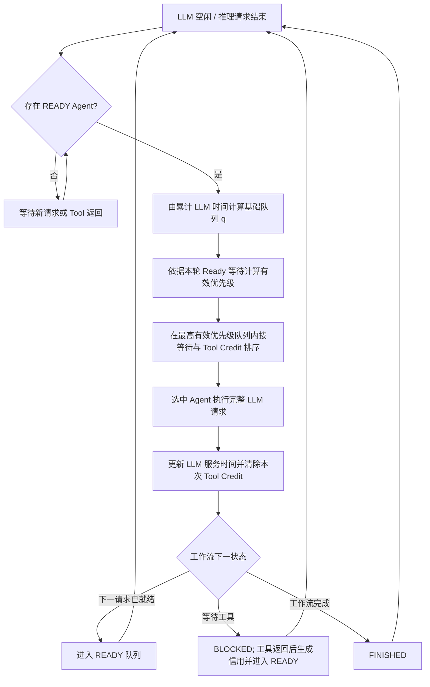

# W-MLFQ：面向多 Agent 工作流的非抢占式 LLM 推理调度

## 1. 系统模型

考虑 $N$ 个 Agent 工作流共享一个常驻 LLM 推理服务。Agent $i$ 由交替发生的 LLM 推理与工具调用构成：

$$
\mathcal{A}_i=(\ell_{i,1},\,\tau_{i,1},\,\ell_{i,2},\,\tau_{i,2},\ldots).
$$

**假设**：

- 同一时刻最多执行一个 LLM 请求；**一次完整推理不可抢占**，只有请求结束后才选择下一个请求。
- Agent 的工具调用不占用 LLM 服务，可与其他 Agent 的推理并行；工具执行期间相应 Agent 处于阻塞状态。
- 调度器只观察已经发生的状态，不预先知道 Agent 的剩余工作量。
- 若 LLM 空闲且存在就绪请求，调度器立即选择一个执行（work-conserving）。

以 Agent 级任务完成时间（Job Completion Time, JCT）为主要优化目标：

$$
\min_{\pi}\ \frac{1}{N}\sum_{i=1}^{N}(C_i-a_i),
$$

其中 $a_i$ 是 Agent 到达时间，$C_i$ 是其工作流完成时间，$\pi$ 是调度策略；同时关注尾延迟与公平性。

## 2. Agent 状态表示

为 Agent $i$ 维护：

$$
S_i(t)=\big(L_i,\,W_i,\,T_i,\,q_i,\,r_i,\,s_i\big).
$$

| 变量  | 含义                                          |
| ----- | --------------------------------------------- |
| $L_i$ | 累计占用 LLM 的实际推理执行时间               |
| $W_i$ | 累计在 LLM Ready 队列中的等待时间（统计指标） |
| $T_i$ | 累计因工具调用而阻塞的墙钟时间                |
| $q_i$ | 基础优先级队列编号，数字越小优先级越高        |
| $r_i$ | 本次进入 Ready 队列的时间戳                   |
| $s_i$ | `READY`、`RUNNING`、`BLOCKED` 或 `FINISHED`   |

状态转移与时间更新：

- `READY → RUNNING`：$W_i\leftarrow W_i+(t-r_i)$。
- `RUNNING → READY/BLOCKED/FINISHED`：$L_i\leftarrow L_i+t_i^{\mathrm{infer}}$。
- `BLOCKED → READY`：$T_i\leftarrow T_i+t_i^{\mathrm{tool}}$，并设置 $r_i=t$。

工具时间只统计阻塞墙钟时间，若工具并行执行，不直接把各工具耗时相加。下一个 LLM 请求尚未准备好时，Agent 不属于 Ready 集合。

## 3. W-MLFQ 调度策略

使用三级队列 $Q_0,Q_1,Q_2$，其中 $Q_0$ 最高优先级。三种时间量分别用于**服务反馈、等待补偿、工具唤醒**。

### 3.1 基于 LLM 占用时间的基础优先级

$$
q_i=\begin{cases}
0,& L_i<\theta_1,\\
1,& \theta_1\le L_i<\theta_2,\\
2,& L_i\ge\theta_2.
\end{cases}
$$

例如 $\theta_1=1\,\mathrm{s}$，$\theta_2=4\,\mathrm{s}$。每次**完整 LLM 推理结束后**累加实际执行时间，重新计算 $q_i$。新一轮请求不会重置 $L_i$；阈值不是单次推理的中断时间片。

### 3.2 Ready 等待时间的 Aging

定义当前连续排队时间：

$$
w_i(t)=t-r_i.
$$

有效优先级：

$$
\boxed{q_i^{\mathrm{eff}}(t)=\max\left(0,\ q_i-\left\lfloor\frac{w_i(t)}{\tau_a}\right\rfloor\right)}
$$

其中 $\tau_a$ 是 Aging 阈值（示例：$2\,\mathrm{s}$）。等待越久，临时有效优先级越高；获得服务后本轮等待计时结束，基础优先级和累计 LLM 时间保持不变。

### 3.3 基于 Tool 阻塞时间的唤醒信用

工具阻塞占比：

$$
\rho_i=\frac{T_i}{L_i+T_i+\epsilon}.
$$

仅在 `BLOCKED → READY` 发生时，计算一次性工具唤醒信用：

$$
\boxed{c_i=c_{\max}\min\left(1,\frac{\rho_i}{\rho_0}\right)}
$$

$\rho_0$ 是工具密集程度参考阈值，$c_{\max}$ 是信用上限。信用**只影响同级队列内排序**，不会直接提升基础优先级；Agent 获得下一次 LLM 服务时清零，避免多次调用无限叠加。

### 3.4 最终选择规则

调度时刻 $t$，Ready Agent 集合为 $\mathcal R(t)$。先筛出最高有效优先级集合：

$$
\mathcal E(t)=\left\{i\in\mathcal R(t):q_i^{\mathrm{eff}}(t)=\min_{j\in\mathcal R(t)}q_j^{\mathrm{eff}}(t)\right\}.
$$

再使用当前排队时间与工具信用排序：

$$
\mathrm{Score}_i(t)=w_i(t)+\lambda c_i,
$$

$$
\boxed{i^*=\arg\max_{i\in\mathcal E(t)}\mathrm{Score}_i(t).}
$$

$\lambda$ 的单位是时间；同分时按进入 Ready 队列的先后顺序选择。

## 4. 调度执行流程

**调度事件**：LLM 空闲时，从 Ready 集合选出 $i^*$ 并执行完整请求；推理结束后更新 $L_i$，按工作流状态转入下一次 Ready、Tool Blocked 或 Finished。Tool 返回时更新 $T_i$ 与 $c_i$，新请求进入 Ready；若 LLM 正忙则不能抢占当前请求。

**初始示例参数（需实验调优）**：$\theta_1=1\,\mathrm{s}$、$\theta_2=4\,\mathrm{s}$、$\tau_a=2\,\mathrm{s}$、$\rho_0=0.5$、$c_{\max}=1$、$\lambda=1\,\mathrm{s}$。

> 说明：该策略是可实现的启发式调度基线；历史 Tool 阻塞高不必然意味着应该优先获得 LLM，因此工具信用的实际价值应通过消融实验验证。