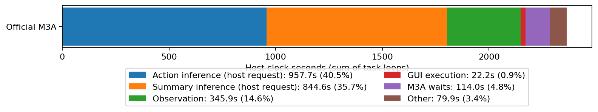
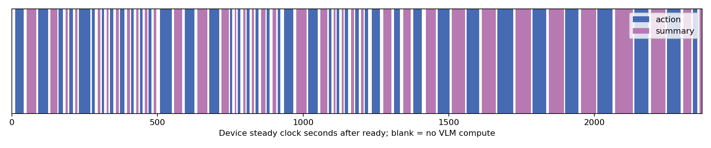
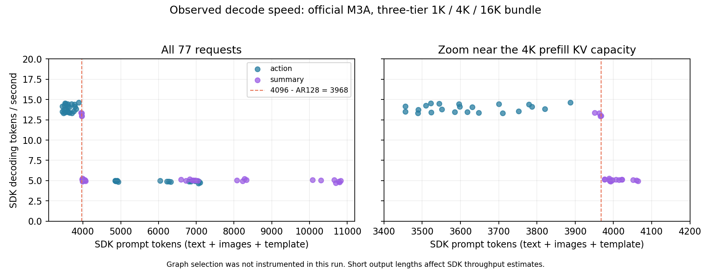

# 手机端 VLM 与 AndroidWorld 实验进展

报告日期：2026 年 11 月 12 日。主要结果来自 11 月 9—11 日真机实验，11 月 6 日和 8 日结果作为历史参照。本次工作是对既有日志和分析结果的汇总，没有新增手机运行。

## 1. 主要结果

本阶段围绕两个目标展开：一是让视觉语言模型在手机 NPU 上稳定执行完整 AndroidWorld 请求；二是测量 GUI Agent 循环中的推理、界面操作与服务空闲时间，为后续任务调度和 KV 管理研究提供依据。

目前得到以下结果：

1. **三档 16K 包已完成手机验收。** Qwen3-VL-4B 的 1K / 4K / 16K 自动选档包能够加载并处理双图输入，最大已测试输入为 15,032 tokens。该长输入仅输出 `OK`，证明容量和生成链路可用，不代表长输入理解质量已验证。
2. **官方 M3A 的四个完整任务均已结束，成功率为 0/4。** 共执行 40 步、77 次推理，其中 40 次动作决策、37 次动作后反思。模型请求全部正常返回，没有上下文跳过或后端中断；任务失败主要表现为重复追加、未替换原文、漏识别目标文件和步数耗尽。
3. **最新任务循环中，LLM 请求占 76.23%，非 LLM 时间占 23.77%。** 四个任务循环合计 2,364.39 秒，即 39.41 分钟。设备端服务 ready→shutdown 窗口的空闲率为 23.96%，模型可以在没有处理请求时继续驻留内存。
4. **长上下文路径的首 token 和后续 Decode 都较慢。** 当前包短输入约 15—18 token/s，9.4K 输入的测试约 5.1 token/s。此前相同输入的图级对照已将主要 Decode 耗时增量定位到 QNN 图执行路径，但尚不能确定某个 Attention 算子、DDR 访问或具体 kernel 是唯一原因。
5. **此前多档 16K 加载卡顿与最新稳定运行应分开看。** 11 月 10 日四档包曾触发全局 OOM；11 月 11 日三档包验收及完整任务运行未观察到新 OOM 或重启。这不能单独证明减少图数是唯一修复原因。

## 2. 实验平台与运行流程

### 2.1 硬件和模型

| 项目 | 配置 |
|---|---|
| 手机 | REDMI K90，设备标识 `189f0fad` |
| SoC / 加速器 | SM8750，Hexagon HTP v79 |
| 系统 | Android 16，真机 ADB/UIAutomator 适配 |
| 模型 | Qwen3-VL-4B-Instruct，W4A16 |
| 运行链路 | 手机常驻 C++ 服务 → GenieX v0.10.0 → QAIRT/QNN 2.50 系列 → NPU |
| 最新部署目录 | `/data/local/tmp/qwen3_vl_geniex_multicl16k_3tier` |
| 文本图 | 4 个分片；每片 1K / 4K / 16K 三档，各有 AR128 Prefill、AR1 Decode，共 6 图/片 |
| 请求设置 | temperature=0，seed=42，BURST；完整任务输出上限 512 tokens |
| 图片输入 | 每次两张图，各自等比例缩放并填白至 512×512 |
| 跨请求状态 | 每次请求 reset KV；当前 VLM 服务尚未实现多 Session 状态保留和切换 |

CL 表示计算图的上下文容量，AR 表示一次处理的输入位置数。Prefill 用 AR128 分块处理输入，Decode 用 AR1 逐 token 执行。四个分片是按层顺序执行的模型部分，三档 CL 是候选图；不是每生成一个 token 就把所有候选图都执行一遍。

### 2.2 电脑与手机的分工

当前 M3A 控制器、提示词组织、截图缩放和任务调度运行在电脑上；界面操作及模型计算发生在手机上。主要数据流如下：

```text
电脑采集手机截图和UI元素
  → M3A组织目标、规则、历史及双图
  → ADB上传提示词和图片
  → 手机CPU分词、预处理、准备Embedding/位置/Mask
  → NPU视觉编码 + 文本Prefill + 逐token Decode
  → 手机返回文本及计时JSON
  → 电脑解析动作，通过ADB操作手机
  → 再次观察界面，调用模型做动作后反思
```

因此，“模型在手机上推理”和“整个 Agent 控制器都在手机上运行”是不同部署方式；本阶段采用前者。

### 2.3 官方流程与真机适配边界

正式入口直接调用上游 `M3A.step` 和 `episode_runner.run_episode`，上游提交为 `55ddaf5edc6f6c25673aed343907d5b9dca66f84`。保留官方提示词、双图输入、历史摘要、正常动作后的反思、1 秒 transition 和 2 秒动作后等待，以及官方任务成功校验。

真机通过 root ADB/UIAutomator 替代模拟器接口；任务初始化创建全新测试文件，避免清除个人存储、恢复快照或修改系统时间。本轮没有人工介入纠正动作，没有按模型剩余上下文缩短输出预算。任务若不能容纳完整输入与 512-token 输出预算，运行器会跳过；本轮实际没有跳过。

这些结果属于**官方 Agent 流程的真机适配实验**，不等同于原始 API33 模拟器完整 benchmark。

## 3. 三档 16K 包验收

11 月 11 日先完成交付包及手机端 SHA256 校验，再在独立目录执行测试，保留旧版部署。无额外诊断 preload 的常驻服务加载耗时为 **7.872 秒**。下表的单次请求耗时不含加载，输入 token 计数包含图片和聊天模板。

| 输入 tokens | 输出 tokens | 单次请求秒 | 首 token 秒 | 视觉编码秒 | SDK prompt_time 秒 | Decode 秒 | Decode token/s |
|---:|---:|---:|---:|---:|---:|---:|---:|
| 558 | 91 | 5.831 | 0.578 | 0.208 | 0.370 | 5.068 | 17.956 |
| 3,840 | 98 | 10.624 | 3.846 | 0.206 | 3.640 | 6.584 | 14.885 |
| 9,429 | 16 | 39.950 | 36.617 | 0.198 | 36.419 | 3.123 | 5.123 |
| 15,032 | 2 | 69.365 | 68.850 | 0.215 | 68.635 | 0.272 | 7.362 |

这组结果说明：

- 短请求仍保留约 15—18 token/s 的生成速度，当前包并非所有请求都固定运行在慢速路径。
- 9,429-token 原官方反思请求在保留双图和 512 输出预算的情况下返回，但输出为动作 JSON，不能据此声称反思内容正确。
- 15,032-token 输入正常返回 `OK`，但仅有 2 个输出 tokens，7.362 token/s 不能代表稳定长输出吞吐。
- 首 token 等待主要落在 SDK 的 prompt 阶段，图像编码仅约 0.2 秒。当前 SDK 的 `prompt_time` 定义为 `TTFT − media_time`，**包含相关准备开销，不是独立测得的纯 NPU Prefill 算子时间**。
- SDK profile、外部回调和整个服务调用的窗口不同，单次请求总耗时不强制等于表中 TTFT 与 Decode 时间之和。

原始响应随本报告保留：[短输入](evidence/short_response.json)、[近4K](evidence/near4k_response.json)、[9.4K](evidence/official_over8k_response.json)、[15K](evidence/long15k_response.json)。

## 4. 四个官方 Markor 任务的完整结果

正式运行目录为 `official_m3a_20261111_140115`。四个任务均以同一初始正文 `The garden has green trees.` 创建全新测试文件，每项最多 12 步，执行期间共享一个常驻模型。

下列表格保留三位小数，合计按未舍入值计算，可能存在末位舍入差异。

| 任务 | 步数 | 动作/反思调用 | 循环秒 | LLM请求秒 | 非LLM秒 | 官方分数 |
|---|---:|---:|---:|---:|---:|---:|
| 页首添加 `Daily update` | 12 | 12/11 | 494.628 | 337.783 | 156.845 | 0 |
| 页尾追加 `End of note.` | 9 | 9/8 | 425.357 | 299.683 | 125.674 | 0 |
| 替换正文 | 7 | 7/6 | 299.555 | 206.793 | 92.762 | 0 |
| 修改内容并重命名 | 12 | 12/12 | 1,144.849 | 958.011 | 186.838 | 0 |
| **合计** | **40** | **40/37** | **2,364.388** | **1,802.269** | **562.119** | **0/4成功** |

失败现象和磁盘核对相符：

- **页首添加**：文字被加到原文末尾，并重复四次；达到步数上限。
- **页尾追加**：目标文字追加三次后，模型宣布完成，未满足精确正文要求。
- **正文替换**：新句子被追加到原文后，原文仍在；模型宣布完成，但官方校验未通过。
- **修改并重命名**：大部分步骤用于桌面或文件列表滚动。第 4 步 UI 元素列表已经包含目标文件，模型仍称未见并滚动；第 11 步才打开正确文件，第 12 步仅点击编辑框。最终正文、文件名均未修改，新文件不存在。

77 次请求全部 `status=ok`，其中 76 次 EOS、1 次达到 512-token 输出上限。达到上限的是页首任务第 5 步动作请求，动作格式无效，官方流程没有执行该动作，也没有进行反思。另两项任务的最终 `status` 动作按官方逻辑没有反思，因此 40 次动作对应 37 次反思。这个长度截断由既定输出上限触发，不能写成上下文不足。

本轮最大输入为 **10,825 tokens**。多次反思仅重复动作 JSON，或者未发现重复输入和替换失败。现阶段已经验证完整调用链，但**任务执行与反思质量尚未达到可靠闭环要求**，不能把模型成功返回等同于用户目标完成。

独立核对显示原有 22 个文件哈希全部不变，仅增加四个测试文件；没有触发无关文件保护拦截。见 [最终文件核对](evidence/final_file_verification.json) 和 [运行诊断](evidence/run_diagnostics.json)。

## 5. 推理、执行与空闲时间

### 5.1 主机任务循环：LLM 76.23%，非 LLM 23.77%

任务循环是四个 episode 的实测时间之和，不含模型加载、循环外任务初始化和终局校验。按主机同一时钟划分互斥阶段：

| 阶段 | 秒 | 循环占比 |
|---|---:|---:|
| 动作决策推理请求 | 957.709 | 40.51% |
| 动作后反思推理请求 | 844.561 | 35.72% |
| 界面采集 | 345.931 | 14.63% |
| GUI动作执行 | 22.235 | 0.94% |
| 官方显式等待 | 114.023 | 4.82% |
| 预处理、上传、日志及其他 | 79.930 | 3.38% |
| **合计** | **2,364.388** | **100.00%** |



主机 LLM 请求时间指发送请求到收到响应的在途时间，含通信；文件上传单列在其他阶段。合计 **1,802.269 秒 / 76.23%**。非 LLM 合计 **562.119 秒 / 23.77%**，包含界面采集、动作、等待和准备开销。

不能把 23.77% 全称作“纯工具执行”。仅界面采集就占 14.63%，其中 UIAutomator 约 269.33 秒、截图约 56.75 秒；GUI 动作执行阶段本身约 22.24 秒，也包含执行器内部短等待。

### 5.2 设备服务窗口：空闲率 23.96%

设备采用自身 steady clock，窗口从模型 ready 到收到 shutdown：

| 指标 | 结果 |
|---|---:|
| 服务窗口 | 2,369.582 秒 |
| 请求 handler 忙碌 | 1,801.928 秒 |
| handler 空闲 | 567.654 秒 |
| **服务空闲率** | **23.96%** |
| 正式运行冷加载，单列 | 8.872 秒 |

这里的分母包含任务初始化、任务间及结束间隙，和主机任务循环不同。两种占比分别在各自时钟内计算，不跨时钟相减。本轮主机/设备区间速率拟合为 1.000000633，接近 1；计时闭合检查通过。



相邻请求之间的设备空档如下：

| 空档类型 | 次数 | 中位秒 | P95秒 |
|---|---:|---:|---:|
| 动作推理结束 → 反思请求 | 37 | 8.491 | 11.375 |
| 反思结束 → 下一动作请求 | 35 | 4.471 | 9.177 |
| 跨任务间隙 | 3 | 13.142 | 13.399 |

包括首尾间隙在内，共 78 个空闲窗口，其中 48 个至少 5 秒，10 个至少 10 秒。这为后续研究后台任务插入、KV 保留和功耗管理提供了测量依据，但不证明这些窗口能无成本回收。

**服务空闲表示没有模型请求处理，不表示 NPU 利用率为零或整机空闲。** 界面采集、执行工具和 Android 前台应用仍可能使用 CPU、GPU及内存带宽。反过来，服务忙碌也包含 CPU 准备和同步等待，不能视为 NPU 全程满负载。

### 5.3 不同历史配置的结果

| 日期及流程 | 任务/成功数 | 步数/推理请求数 | 循环秒 | LLM占比 | 非LLM占比 | 设备服务空闲率 |
|---|---|---|---:|---:|---:|---:|
| 11月6日，4K简化代理 | 6/2 | 67/67 | 510.386 | 44.96% | 55.04% | 57.52% |
| 11月8日，固定16K官方M3A | 2/0 | 26/50 | 2,898.804 | 82.82% | 17.18% | 17.28% |
| 11月10日，多档8K官方M3A | 2/0 | 20/38 | 648.601 | 58.82% | 41.18% | 41.42% |
| 11月11日，三档16K官方M3A | 4/0 | 40/77 | 2,364.388 | 76.23% | 23.77% | 23.96% |

这些是历史概览，**不是受控加速比实验**。11 月 6 日为简化流程，没有官方动作后反思，且包含完成校验反馈重试；后续模型包、目标名称、动作轨迹、步数和任务类型也不同。11 月 8 日还检测到主机/设备区间速率约 1.0613 的差异，其占比已按同钟口径计算，不能将两个时钟的原始秒数直接相减。

空闲率会随模型速度、任务轨迹和观测开销改变，不能把某轮数值当作手机 GUI Agent 的通用常量。历史数字汇总见 [historical_timing_summary.json](evidence/historical_timing_summary.json)。

## 6. Decode 下降的定位

### 6.1 受控输入证明：更长的输入不是全部解释

11 月 9 日使用同一手机、runner、BURST、temperature=0、seed=42、相同提示词和双图开展旧4K与旧固定16K对照，每请求 reset KV。558 输入 tokens、91 输出 tokens 的结果如下：

| 条件 | 实际Decode CL | SDK token/s | 每轮四片QNN调用累计ms |
|---|---:|---:|---:|
| 旧包自动 | 1,024 | 16.654 | 48.81 |
| 旧包强制2K | 2,048 | 16.651 | 50.60 |
| 旧包强制4K | 4,096 | 14.310 | 58.03 |
| 旧固定16K包 | 16,384 | 4.821 | 197.21 |
| 旧包1K复测 | 1,024 | 18.025 | 46.29 |

实际图名及分层耗时由独立诊断库记录。1K 前后两组合并约 17.31 token/s，16K 约 4.82 token/s。相同输入仍存在明显差距，证明不能仅用 prompt 变长解释。

另一组 3,840 输入、98 输出的对照中，旧4K前后合并 **14.139 token/s**，旧固定16K为 **4.830 token/s**，每 token 耗时约为前者的 **2.93 倍**；每轮 QNN 调用约 58—60 ms 对比 197—198 ms。

旧短输入对照中，QNN 调用耗时增量约占 SDK Decode 增量的 98.9%；CPU `updateKV` 的所有 worker 墙钟合计仅约 0.07—0.15 秒/整条请求，且可能与图执行重叠。因此可以把主要增量定位到 QNN 图执行路径，不能把各层墙钟简单相加，也不能把 98.9% 解读为某个算子或纯 NPU 算术的占比。

以上图级插桩结果属于 11 月 9 日的旧包实验；最新三档包没有逐请求图级插桩，不能混作同一次测量。

### 6.2 最新三档包：3,968 tokens 附近出现速度突变

本轮官方 M3A 日志中的边界样本为：

| 输入 tokens | 输出 tokens | SDK Decode token/s |
|---:|---:|---:|
| 3,968 | 14 | 12.982 |
| 3,977 | 14 | 5.151 |
| 3,977 | 15 | 5.184 |



源码机制提供了与之吻合的解释：AR128 Prefill 的 KV 输入容量为 `CL−128`，4K 档对应 3,968。处理当前输入块时，一旦所需 KV 超过该容量，运行时向更高 CL 升档；当前下一档直接是 16K，Decode 沿用 active CL。因此不到 4,096 输入 tokens，也可能已经进入 16K Decode 路径。

这是一项**源码与实测行为高度吻合的判断**，尚不能替代当前包的逐请求选图 trace。边界样本也不是相同 prompt 的单变量实验，短输出会影响吞吐估计。

### 6.3 已确认与待验证的机制

| 判断 | 证据及边界 |
|---|---|
| 大图路径会影响逐token速度 | 旧包中同输入强制1K/2K/4K，以及固定16K对照有实际图执行记录 |
| 主要耗时增量位于QNN调用 | 旧图级诊断已确认；QNN墙钟还包括驱动、RPC和同步 |
| CPU每token整块复制16K KV导致减速 | 不受当前源码和旧测量支持；更新主要写回本轮新增KV |
| 静态图更大的Attention/KV尺寸可能增加成本 | 实际I/O规格支持尺寸扩大；未测具体kernel的裁剪、分块和DDR流量 |
| 温度、内存压力或降频是唯一主因 | 未获证实；没有当前NPU实际频率及算子带宽分解 |

按当前 uint8 KV 接口，36 层 K+V 的输入描述容量约为 4K 档 287.93 MiB、16K 档 1,151.93 MiB。该数值是张量容量，不是每 token 实测读取流量，也不能按档位数相加当作独立物理分配。

完整任务中动作请求 Decode 中位数为 13.345 token/s，反思为 5.068 token/s；两类输入长度、选档和输出长度不同，不代表动作与反思是两套速度不同的模型。

## 7. 加载失败、内存与稳定性

### 7.1 11月10日四档包的全局OOM

四档 1K / 4K / 8K / 16K 包曾在模型 ready 前进入 Qualcomm DMA heap 分配路径并触发全局 OOM。模型继承 `oom_score_adj=-1000`，被排除在普通 OOM 选择之外，窗口内有 18 条明确的进程被杀记录，包括 SystemUI 和触摸相关服务。这解释了手机无响应为何不仅表现为模型加载失败。

该次重试前后 boot_id 一致，**没有重启**；模型退出后内存恢复，用户确认手机恢复正常。更早另一次尝试记录过重启，属于不同运行，不应合并描述。

将模型 OOM 分数设为 1000并读回检查，是防止模型被过度保护的措施，不会减少模型本身的内存需求。删除某个小档位也不会必然按完整 KV 大小节省内存，因为部分I/O按同名张量的最大尺寸复用。

### 7.2 11月11日三档包的观测

三档包的验收与完整任务运行均未观察到新全局 OOM或重启。本轮完整任务的 444 个只读内存样本中，最低 MemAvailable 为 **983,552 kB，约 960.5 MiB**；采样间隔约 5 秒，该值不是连续测得的精确峰值。模型 `oom_score_adj` 采样均为 1000。

结束后服务正常退出，MemAvailable 恢复至约 11.1 GiB，boot_id 保持不变，USB保持亮屏设置恢复原值0，手机包72项SHA256再次通过。

部分加载日志仍有 QNN 映射错误行，之后模型成功就绪并返回全部请求，故不能把单条 ERROR 当作整次加载失败，也不能声称加载日志完全无错。

候选包同时经历重新链接、OOM优先级保护及系统状态变化，现阶段只能确认它通过了这组测试，尚未完成分配级归因，不能认定减图是唯一成功原因。

### 7.3 交付采样器的退出问题

原交付 `oom_guard.sh` 的后台采样器只检查 PID 存在与启动时间；模型退出进入 Z 状态后仍可能继续采样，使 ADB启动命令无法正常结束。该现象可在 guard 后执行 `/system/bin/true` 复现，不需要运行模型。

独立补丁增加 Z/X/空状态退出检查，空程序验证约0.229秒正常结束。补丁没有替换交付包原件，也没有通过重跑完整原版 smoke 脚本做进一步验证。本轮完整 M3A 使用常驻服务自身的 OOM 写入/读回检查和主机侧监控，没有使用该后台采样循环。不能将此前 ADB 的60秒退出超时计作模型加载时间。

## 8. 当前结论与下一步

目前完成的是：手机端16K VLM部署和长输入容量验证、官方M3A完整调用链验证、推理/执行/空闲时间分解，以及旧包Decode的图级定位。尚未完成可靠GUI任务闭环、多Session VLM状态管理，或NPU算子级资源归因。

建议后续按以下顺序推进：

1. **补齐可靠任务样本。** 对重复追加、替换失败、漏选目标和反思无效进行分类；用可独立校验的小任务建立成功样本。若修改提示词或Agent流程，单列为派生实验，保留未改官方M3A基线。
2. **在当前三档包确认实际选图。** 对3,968附近做边界扫描；再以相同输入强制4K/16K，对照输出和每分片QNN耗时，将当前源码推断变为直接执行证据。
3. **再做算子级定位。** 区分Attention、量化/数据布局转换、DDR访问、RPC/同步和频率，避免只根据CL或KV容量推算耗时。
4. **建立任务阶段与KV接口。** 当前VLM每次reset，需要先验证前缀/多模态状态有效性和保存恢复能力，才能研究利用空闲窗口处理其他任务、联合安排请求与KV驻留。
5. **把前台响应作为约束。** 约4—8秒的空档未必能装下一条完整后台推理；还需测可让出执行段、切换成本及对界面采集的资源争用。单前台GUI也限制了两个任务的直接交错。

四个最新任务均失败，样本规模较小，未做多轮随机化和置信区间评估；本报告不将空闲率、吞吐或稳定性推广为所有手机Agent任务的通用结论。

## 9. 代码、复现与原始证据

11月12日独立代码项目已迁入 `/home/lyyyy/edge_side_work/code`，旧路径保留兼容链接。迁移仅修正路径定位和文档，没有重写历史实验记录；模型交付包保持原样。

| 位置 | 内容 |
|---|---|
| `code/android_world_phone` | 正式入口、真机适配、常驻服务、计时与诊断 |
| `code/android_world_upstream` | AndroidWorld上游源码 |
| `code/geniex_validation` | 早期模型验收脚本和结果 |
| `code/multisession_kv` | 既有多会话KV、轨迹回放及AppWorld实验 |
| 工作区根目录 `phone_bundle*` | 各版模型、运行库和原始交付脚本 |

最新完整任务的等价启动命令如下；原始运行时工作目录为旧路径，原始参数另存于[launch_command_original.json](evidence/launch_command_original.json)。实际完整手机端启动命令保存在[phone_launch_command.json](evidence/phone_launch_command.json)。

```bash
cd /home/lyyyy/edge_side_work/code/android_world_phone
.venv/bin/python -u run_official_m3a.py \
  --tasks extended --repeats 1 --max-new-tokens 512 \
  --skip-context-tight-tasks --request-timeout 600 \
  --remote-bundle /data/local/tmp/qwen3_vl_geniex_multicl16k_3tier

.venv/bin/python analyze_official_timing.py \
  results/official_m3a_20261111_140115
```

本报告附带轻量证据副本和图片，可独立查看主要数字：

- [计时数字汇总](evidence/official_m3a_summary.json)、[逐请求指标](evidence/requests.csv)、[任务汇总](evidence/tasks.csv)。
- [设备侧服务区间](evidence/service_stats.json)、[模型/环境/源码指纹](evidence/manifest.json)。
- [运行诊断](evidence/run_diagnostics.json)、[独立文件核对](evidence/final_file_verification.json)。
- [旧短输入图级诊断数据](evidence/decode_short_diagnosis.json)、[旧近4K对照数据](evidence/decode_near4k_summary.json)。
- [证据源路径、大小和SHA256清单](evidence/SOURCES.json)。

完整原始日志和逐步截图/提示词仍在原实验目录：

- [11月11日完整GUI运行](</home/lyyyy/edge_side_work/code/android_world_phone/results/official_m3a_20261111_140115/RUN_REPORT.md>)、[phone_raw.log](</home/lyyyy/edge_side_work/code/android_world_phone/results/official_m3a_20261111_140115/phone_raw.log>)。
- [11月11日模型包验收](</home/lyyyy/edge_side_work/code/android_world_phone/results/multicl16k_3tier_acceptance_20261111_133344/REPORT.md>)。
- [11月10日8K官方任务](</home/lyyyy/edge_side_work/code/android_world_phone/results/official_m3a_20261110_142917/RUN_REPORT.md>)。
- [11月9日短输入图级定位](</home/lyyyy/edge_side_work/code/android_world_phone/results/decode_diagnosis_20261109_134535/REPORT.md>)、[近4K对照](</home/lyyyy/edge_side_work/code/android_world_phone/results/decode_diagnosis_20261109_142443/REPORT.md>)。
- [11月10日多档16K加载失败分析](</home/lyyyy/edge_side_work/code/android_world_phone/results/multicl16k_retry_20261110_191803/FAILURE_ANALYSIS.md>)。

附带副本与来源文件逐字节一致，完整来源关系见清单。原始manifest对应当时运行的代码；迁移后的少量路径修改另有记录，不回写原始指纹。
